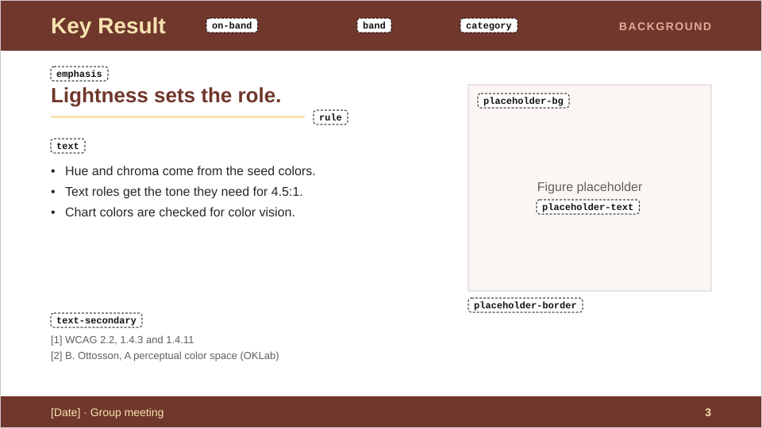
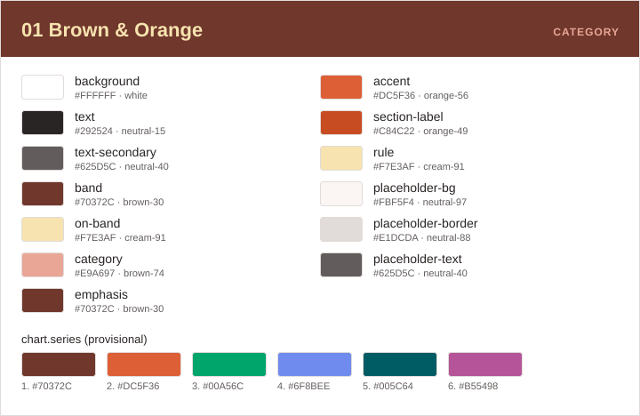
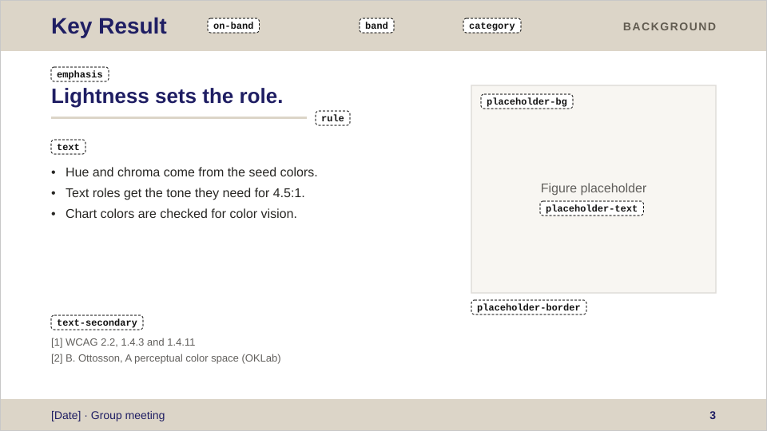
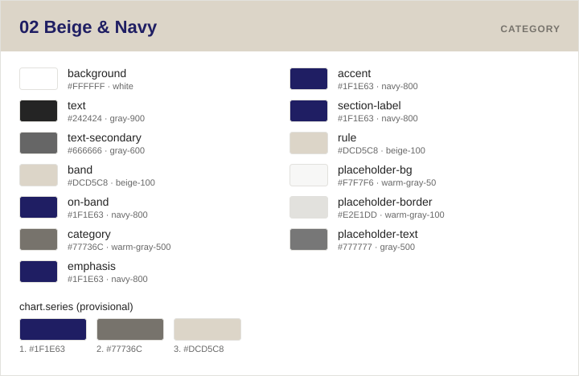
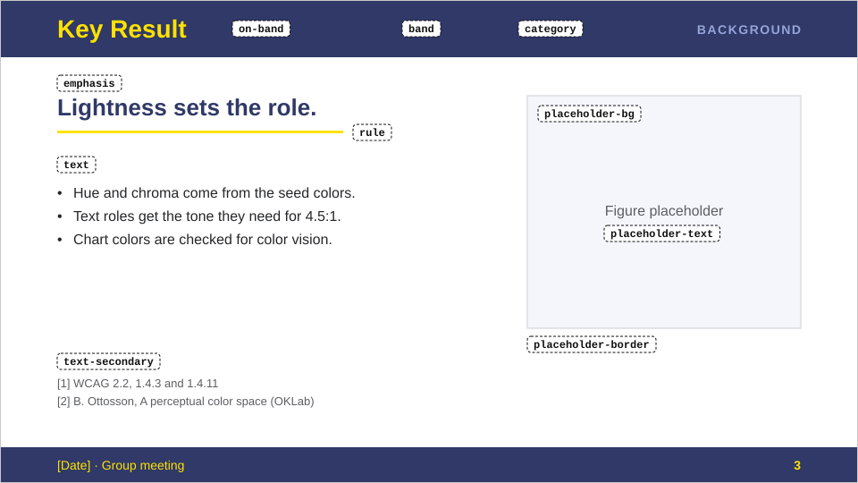
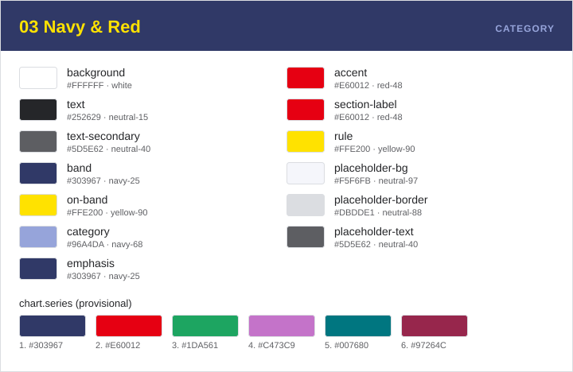
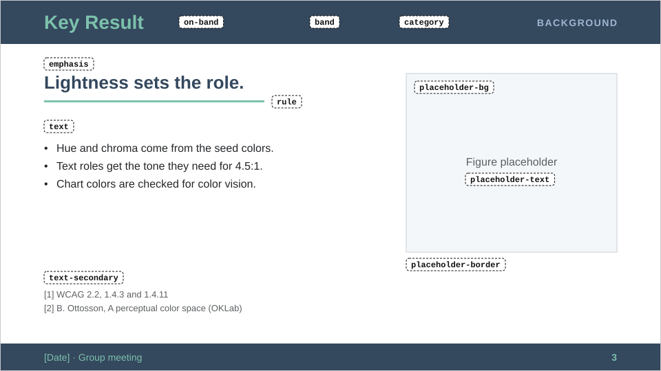
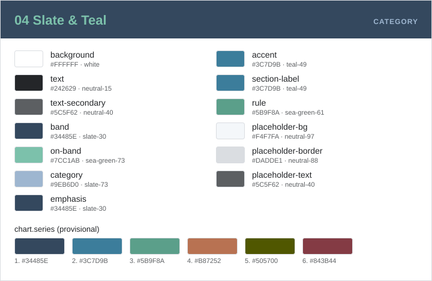

# design-themes

研究発表スライド、論文・ポスターの図（matplotlib）、LaTeX/Beamer、Web ページで共通に使うデザインテーマ（カラーパレット＋フォント）集。各プロジェクトは **テーマ番号**（例: `02`）を選んで使う。

- **正本は 1 テーマ 1 ファイル**: `themes/<番号>-<slug>/theme.json` だけを手で編集する。CSS・mplstyle・LaTeX などは `scripts/build.py` が `dist/<番号>/` に生成する。
- **人が決めるのは種色 3 つだけ**: 各テーマのベース・アクセント・サブの 3 色を決めると、残りの色（文字色・グレー・文字用に明度を変えた色・グラフの系列色）は `scripts/derive.py` が決まった手順で導出する（[配色の作り方](#配色の作り方)）。種色の値は変えない。
- **番号は永久 ID**: 一度割り当てた番号は振り直さず、再利用もしない。廃止するテーマは削除せず `"status": "deprecated"` にする。
- **生成物もコミットする**: `dist/` はコミット済みなので、ビルドしなくても他のプロジェクトから使える。CI で `dist/` が `theme.json` と一致しているかを検証する。
- **依存は最小限**: Python 3.10 以上の標準ライブラリだけで動く（テストのみ pytest を使う）。

`theme.json` は `seeds`（種色 3 つ）、`palette`（生の色。名前は `<色名>-<明度>`）と `roles`（意味づけ。`palette` の名前を参照する）に分かれている。スライドもグラフも Web も **`roles` を参照して色を決める**。`roles` のキーは全テーマで共通なので、テーマ番号を差し替えてもコードは壊れない。

## テーマ一覧

<!-- BEGIN GENERATED: themes -->
<!-- この区間は scripts/build.py が themes/*/theme.json から生成する。手で編集しないこと。 -->

| 番号 | 名前 | slug | 状態 | 種色（ベース / アクセント / サブ） |
|---|---|---|---|---|
| `01` | Brown & Orange | `brown-orange` | active | `#70372C` / `#DC5F36` / `#F7E3AF` |
| `02` | Beige & Navy | `beige-navy` | active | `#DCD5C8` / `#A2A2AD` / `#1F1E63` |
| `03` | Navy & Red | `navy-red` | active | `#303967` / `#E60012` / `#FFE200` |
| `04` | Slate & Teal | `slate-teal` | active | `#34485E` / `#3C7D9B` / `#5B9F8A` |

### 01 Brown & Orange



見本スライド 5 枚（表紙・セクション扉・本文・グラフ・役割一覧）: [themes/01-brown-orange/README.md](themes/01-brown-orange/README.md#プレビュー)



- slug: `brown-orange` / 状態: `active`
- 出典: 種色はユーザー指定（2026-11-06）。それ以外は scripts/derive.py で導出
- フォント: 欧文 Arial（代替: Helvetica, sans-serif）、和文 Meiryo UI（代替: Hiragino Sans, Noto Sans JP, sans-serif）
- 使い方のルール: [themes/01-brown-orange/README.md](themes/01-brown-orange/README.md) ・ 正本: [themes/01-brown-orange/theme.json](themes/01-brown-orange/theme.json) ・ 生成物: [dist/01/](dist/01/)

**種色**（値は変えない。白地・帯の上で基準に届かない種色は、その用途にだけ明度を変えた色を使う）

| 種色 | palette | hex | 明度 L* | 白地（`background`） | 帯（`band`）の上 | そのまま使う場所 |
|---|---|---|---|---|---|---|
| ベース | `brown-30` | `#70372C` | 30.3 | 9.24:1（文字 ✓） | — | `band`、`emphasis`、系列 1 |
| アクセント | `orange-56` | `#DC5F36` | 55.8 | 3.66:1（線・図形 ✓ / 文字 ✗） | 2.52:1（⚠ 文字・線とも ✗） | `accent`、系列 2 |
| サブ | `cream-91` | `#F7E3AF` | 90.7 | 1.26:1（⚠ 文字・線とも ✗） | 7.29:1（文字 ✓） | `on-band`、`rule` |

| role | palette | hex | 由来 | 使われ方 | 検査 | コントラスト |
|---|---|---|---|---|---|---|
| `background` | `white` | `#FFFFFF` | 固定 | スライド背景 | 面 | — |
| `text` | `neutral-15` | `#292524` | `brown-30` の色相・彩度 0.006・明度 15 | 本文 | 文字 4.5:1 | 15.16:1 vs `background` ✓ |
| `text-secondary` | `neutral-40` | `#625D5C` | `brown-30` の色相・彩度 0.006・明度 40 | 参考文献、図キャプション | 文字 4.5:1 | 6.48:1 vs `background` ✓ |
| `band` | `brown-30` | `#70372C` | 種色（ベース） | ヘッダー帯・フッター帯の塗り | 面 | — |
| `on-band` | `cream-91` | `#F7E3AF` | 種色（サブ） | 帯の上のスライドタイトル、日付・会議名・ページ番号 | 文字 4.5:1 | 7.29:1 vs `band` ✓ |
| `category` | `brown-74` | `#E9A697` | `brown-30` の色相・明度 74 | 帯の右上のカテゴリラベル（BACKGROUND など） | 文字 4.5:1 | 4.56:1 vs `band` ✓ |
| `emphasis` | `brown-30` | `#70372C` | 種色（ベース） | 表紙タイトル、セクションタイトル、キーメッセージ、Takeaway | 文字 4.5:1 | 9.24:1 vs `background` ✓ |
| `accent` | `orange-56` | `#DC5F36` | 種色（アクセント） | 表紙のアクセントライン、セクション扉の縦バー | 線・図形 3:1 | 3.66:1 vs `background` ✓ 線・図形 / ⚠ 文字には不可 |
| `section-label` | `orange-49` | `#C84C22` | `orange-56` の色相・明度 49 | セクション扉の「01 / SECTION」 | 文字 4.5:1 | 4.65:1 vs `background` ✓ |
| `rule` | `cream-91` | `#F7E3AF` | 種色（サブ） | キーメッセージ下の区切り線 | 装飾（対象外） | 1.26:1 vs `background` |
| `placeholder-bg` | `neutral-97` | `#FBF5F4` | `brown-30` の色相・彩度 0.006・明度 97 | 図プレースホルダーの塗り | 面 | — |
| `placeholder-border` | `neutral-88` | `#E1DCDA` | `brown-30` の色相・彩度 0.006・明度 88 | 図プレースホルダーの枠線 | 装飾（対象外） | 1.26:1 vs `placeholder-bg` |
| `placeholder-text` | `neutral-40` | `#625D5C` | `brown-30` の色相・彩度 0.006・明度 40 | 図プレースホルダーの文字 | 文字 4.5:1 | 6.00:1 vs `placeholder-bg` ✓ |

**グラフ系列色（`chart.series`）: 暫定案・要確認**

1. `brown-30` `#70372C` — 種色（ベース）、9.24:1 vs `background` ✓
2. `orange-56` `#DC5F36` — 種色（アクセント）、3.66:1 vs `background` ✓
3. `green-60` `#00A56C` — 追加色（色相 160°・彩度 0.15・明度 60）、3.18:1 vs `background` ✓
4. `blue-60` `#6F8BEE` — 追加色（色相 270°・彩度 0.15・明度 60）、3.18:1 vs `background` ✓
5. `teal-35` `#005C64` — 追加色（色相 205°・彩度 0.15・明度 35）、7.73:1 vs `background` ✓
6. `magenta-50` `#B55498` — 追加色（色相 340°・彩度 0.15・明度 50）、4.48:1 vs `background` ✓

系列色どうしの最小の色差: ΔE00 12.2（3 型色覚、3 と 4）。一般色覚と 1〜3 型色覚のシミュレーションで計算し、目安 10 未満を警告する。

**警告**（種色の値は変更していない）

- ⚠ `accent`（orange-56 #DC5F36）on `background`（#FFFFFF）= 3.66:1。線・図形の基準 3:1 は満たすが、小さい文字には使えない（4.5:1 未満）

### 02 Beige & Navy



見本スライド 5 枚（表紙・セクション扉・本文・グラフ・役割一覧）: [themes/02-beige-navy/README.md](themes/02-beige-navy/README.md#プレビュー)



- slug: `beige-navy` / 状態: `active`
- 出典: 種色はユーザー指定（2026-11-06）。それ以外は scripts/derive.py で導出
- フォント: 欧文 Arial（代替: Helvetica, sans-serif）、和文 Meiryo UI（代替: Hiragino Sans, Noto Sans JP, sans-serif）
- 使い方のルール: [themes/02-beige-navy/README.md](themes/02-beige-navy/README.md) ・ 正本: [themes/02-beige-navy/theme.json](themes/02-beige-navy/theme.json) ・ 生成物: [dist/02/](dist/02/)

**種色**（値は変えない。白地・帯の上で基準に届かない種色は、その用途にだけ明度を変えた色を使う）

| 種色 | palette | hex | 明度 L* | 白地（`background`） | 帯（`band`）の上 | そのまま使う場所 |
|---|---|---|---|---|---|---|
| ベース | `beige-85` | `#DCD5C8` | 85.5 | 1.45:1（⚠ 文字・線とも ✗） | — | `band`、`rule` |
| アクセント | `cool-gray-67` | `#A2A2AD` | 66.9 | 2.52:1（⚠ 文字・線とも ✗） | 1.73:1（⚠ 文字・線とも ✗） | `accent` |
| サブ | `navy-16` | `#1F1E63` | 16.1 | 14.74:1（文字 ✓） | 10.10:1（文字 ✓） | `on-band`、`emphasis`、系列 1 |

| role | palette | hex | 由来 | 使われ方 | 検査 | コントラスト |
|---|---|---|---|---|---|---|
| `background` | `white` | `#FFFFFF` | 固定 | スライド背景 | 面 | — |
| `text` | `neutral-15` | `#272623` | `beige-85` の色相・彩度 0.006・明度 15 | 本文 | 文字 4.5:1 | 15.13:1 vs `background` ✓ |
| `text-secondary` | `neutral-40` | `#605E5B` | `beige-85` の色相・彩度 0.006・明度 40 | 参考文献、図キャプション | 文字 4.5:1 | 6.46:1 vs `background` ✓ |
| `band` | `beige-85` | `#DCD5C8` | 種色（ベース） | ヘッダー帯・フッター帯の塗り | 面 | — |
| `on-band` | `navy-16` | `#1F1E63` | 種色（サブ） | 帯の上のスライドタイトル、日付・会議名・ページ番号 | 文字 4.5:1 | 10.10:1 vs `band` ✓ |
| `category` | `beige-39` | `#615B50` | `beige-85` の色相・明度 39 | 帯の右上のカテゴリラベル（BACKGROUND など） | 文字 4.5:1 | 4.61:1 vs `band` ✓ |
| `emphasis` | `navy-16` | `#1F1E63` | 種色（サブ） | 表紙タイトル、セクションタイトル、キーメッセージ、Takeaway | 文字 4.5:1 | 14.74:1 vs `background` ✓ |
| `accent` | `cool-gray-67` | `#A2A2AD` | 種色（アクセント） | 表紙のアクセントライン、セクション扉の縦バー | 線・図形 3:1 | **2.52:1** vs `background` ⚠ 基準未満 |
| `section-label` | `cool-gray-49` | `#74747E` | `cool-gray-67` の色相・明度 49 | セクション扉の「01 / SECTION」 | 文字 4.5:1 | 4.62:1 vs `background` ✓ |
| `rule` | `beige-85` | `#DCD5C8` | 種色（ベース） | キーメッセージ下の区切り線 | 装飾（対象外） | 1.45:1 vs `background` |
| `placeholder-bg` | `neutral-97` | `#F8F6F2` | `beige-85` の色相・彩度 0.006・明度 97 | 図プレースホルダーの塗り | 面 | — |
| `placeholder-border` | `neutral-88` | `#DFDCD8` | `beige-85` の色相・彩度 0.006・明度 88 | 図プレースホルダーの枠線 | 装飾（対象外） | 1.26:1 vs `placeholder-bg` |
| `placeholder-text` | `neutral-40` | `#605E5B` | `beige-85` の色相・彩度 0.006・明度 40 | 図プレースホルダーの文字 | 文字 4.5:1 | 5.98:1 vs `placeholder-bg` ✓ |

**グラフ系列色（`chart.series`）: 暫定案・要確認**

1. `navy-16` `#1F1E63` — 種色（サブ）、14.74:1 vs `background` ✓
2. `cool-gray-61` `#92929D` — `cool-gray-67` の色相・明度 61、3.07:1 vs `background` ✓
3. `olive-35` `#505700` — 追加色（色相 115°・彩度 0.118・明度 35）、7.76:1 vs `background` ✓
4. `red-40` `#9A424C` — 追加色（色相 15°・彩度 0.118・明度 40）、6.44:1 vs `background` ✓
5. `teal-40` `#006972` — 追加色（色相 205°・彩度 0.118・明度 40）、6.43:1 vs `background` ✓
6. `ochre-60` `#BC8732` — 追加色（色相 75°・彩度 0.118・明度 60）、3.15:1 vs `background` ✓

系列色どうしの最小の色差: ΔE00 12.3（2 型色覚、3 と 4）。一般色覚と 1〜3 型色覚のシミュレーションで計算し、目安 10 未満を警告する。

**警告**（種色の値は変更していない）

- ⚠ `accent`（cool-gray-67 #A2A2AD）on `background`（#FFFFFF）= 2.52:1。線・図形の基準 3:1 未満（線・マーカーには不向き）

### 03 Navy & Red



見本スライド 5 枚（表紙・セクション扉・本文・グラフ・役割一覧）: [themes/03-navy-red/README.md](themes/03-navy-red/README.md#プレビュー)



- slug: `navy-red` / 状態: `active`
- 出典: 種色はユーザー指定（2026-11-06）。それ以外は scripts/derive.py で導出
- フォント: 欧文 Arial（代替: Helvetica, sans-serif）、和文 Meiryo UI（代替: Hiragino Sans, Noto Sans JP, sans-serif）
- 使い方のルール: [themes/03-navy-red/README.md](themes/03-navy-red/README.md) ・ 正本: [themes/03-navy-red/theme.json](themes/03-navy-red/theme.json) ・ 生成物: [dist/03/](dist/03/)

**種色**（値は変えない。白地・帯の上で基準に届かない種色は、その用途にだけ明度を変えた色を使う）

| 種色 | palette | hex | 明度 L* | 白地（`background`） | 帯（`band`）の上 | そのまま使う場所 |
|---|---|---|---|---|---|---|
| ベース | `navy-25` | `#303967` | 25.4 | 11.01:1（文字 ✓） | — | `band`、`emphasis`、系列 1 |
| アクセント | `red-48` | `#E60012` | 48.1 | 4.80:1（文字 ✓） | 2.29:1（⚠ 文字・線とも ✗） | `accent`、`section-label`、系列 2 |
| サブ | `yellow-90` | `#FFE200` | 89.7 | 1.30:1（⚠ 文字・線とも ✗） | 8.45:1（文字 ✓） | `on-band`、`rule` |

| role | palette | hex | 由来 | 使われ方 | 検査 | コントラスト |
|---|---|---|---|---|---|---|
| `background` | `white` | `#FFFFFF` | 固定 | スライド背景 | 面 | — |
| `text` | `neutral-15` | `#252629` | `navy-25` の色相・彩度 0.006・明度 15 | 本文 | 文字 4.5:1 | 15.13:1 vs `background` ✓ |
| `text-secondary` | `neutral-40` | `#5D5E62` | `navy-25` の色相・彩度 0.006・明度 40 | 参考文献、図キャプション | 文字 4.5:1 | 6.47:1 vs `background` ✓ |
| `band` | `navy-25` | `#303967` | 種色（ベース） | ヘッダー帯・フッター帯の塗り | 面 | — |
| `on-band` | `yellow-90` | `#FFE200` | 種色（サブ） | 帯の上のスライドタイトル、日付・会議名・ページ番号 | 文字 4.5:1 | 8.45:1 vs `band` ✓ |
| `category` | `navy-68` | `#96A4DA` | `navy-25` の色相・明度 68 | 帯の右上のカテゴリラベル（BACKGROUND など） | 文字 4.5:1 | 4.52:1 vs `band` ✓ |
| `emphasis` | `navy-25` | `#303967` | 種色（ベース） | 表紙タイトル、セクションタイトル、キーメッセージ、Takeaway | 文字 4.5:1 | 11.01:1 vs `background` ✓ |
| `accent` | `red-48` | `#E60012` | 種色（アクセント） | 表紙のアクセントライン、セクション扉の縦バー | 線・図形 3:1 | 4.80:1 vs `background` ✓ |
| `section-label` | `red-48` | `#E60012` | 種色（アクセント） | セクション扉の「01 / SECTION」 | 文字 4.5:1 | 4.80:1 vs `background` ✓ |
| `rule` | `yellow-90` | `#FFE200` | 種色（サブ） | キーメッセージ下の区切り線 | 装飾（対象外） | 1.30:1 vs `background` |
| `placeholder-bg` | `neutral-97` | `#F5F6FB` | `navy-25` の色相・彩度 0.006・明度 97 | 図プレースホルダーの塗り | 面 | — |
| `placeholder-border` | `neutral-88` | `#DBDDE1` | `navy-25` の色相・彩度 0.006・明度 88 | 図プレースホルダーの枠線 | 装飾（対象外） | 1.26:1 vs `placeholder-bg` |
| `placeholder-text` | `neutral-40` | `#5D5E62` | `navy-25` の色相・彩度 0.006・明度 40 | 図プレースホルダーの文字 | 文字 4.5:1 | 6.00:1 vs `placeholder-bg` ✓ |

**グラフ系列色（`chart.series`）: 暫定案・要確認**

1. `navy-25` `#303967` — 種色（ベース）、11.01:1 vs `background` ✓
2. `red-48` `#E60012` — 種色（アクセント）、4.80:1 vs `background` ✓
3. `green-60` `#1DA561` — 追加色（色相 155°・彩度 0.15・明度 60）、3.17:1 vs `background` ✓
4. `magenta-60` `#C473C9` — 追加色（色相 325°・彩度 0.15・明度 60）、3.16:1 vs `background` ✓
5. `teal-45` `#007680` — 追加色（色相 205°・彩度 0.15・明度 45）、5.38:1 vs `background` ✓
6. `rose-35` `#97264C` — 追加色（色相 5°・彩度 0.15・明度 35）、7.78:1 vs `background` ✓

系列色どうしの最小の色差: ΔE00 12.8（1 型色覚、1 と 6）。一般色覚と 1〜3 型色覚のシミュレーションで計算し、目安 10 未満を警告する。

**警告**（種色の値は変更していない）

- なし

### 04 Slate & Teal



見本スライド 5 枚（表紙・セクション扉・本文・グラフ・役割一覧）: [themes/04-slate-teal/README.md](themes/04-slate-teal/README.md#プレビュー)



- slug: `slate-teal` / 状態: `active`
- 出典: 種色はユーザー指定（2026-11-06）。それ以外は scripts/derive.py で導出
- フォント: 欧文 Arial（代替: Helvetica, sans-serif）、和文 Meiryo UI（代替: Hiragino Sans, Noto Sans JP, sans-serif）
- 使い方のルール: [themes/04-slate-teal/README.md](themes/04-slate-teal/README.md) ・ 正本: [themes/04-slate-teal/theme.json](themes/04-slate-teal/theme.json) ・ 生成物: [dist/04/](dist/04/)

**種色**（値は変えない。白地・帯の上で基準に届かない種色は、その用途にだけ明度を変えた色を使う）

| 種色 | palette | hex | 明度 L* | 白地（`background`） | 帯（`band`）の上 | そのまま使う場所 |
|---|---|---|---|---|---|---|
| ベース | `slate-30` | `#34485E` | 29.8 | 9.39:1（文字 ✓） | — | `band`、`emphasis`、系列 1 |
| アクセント | `teal-49` | `#3C7D9B` | 49.5 | 4.56:1（文字 ✓） | 2.05:1（⚠ 文字・線とも ✗） | `accent`、`section-label`、系列 2 |
| サブ | `sea-green-61` | `#5B9F8A` | 60.7 | 3.10:1（線・図形 ✓ / 文字 ✗） | 3.03:1（線・図形 ✓ / 文字 ✗） | `rule`、系列 3 |

| role | palette | hex | 由来 | 使われ方 | 検査 | コントラスト |
|---|---|---|---|---|---|---|
| `background` | `white` | `#FFFFFF` | 固定 | スライド背景 | 面 | — |
| `text` | `neutral-15` | `#242629` | `slate-30` の色相・彩度 0.006・明度 15 | 本文 | 文字 4.5:1 | 15.17:1 vs `background` ✓ |
| `text-secondary` | `neutral-40` | `#5C5F62` | `slate-30` の色相・彩度 0.006・明度 40 | 参考文献、図キャプション | 文字 4.5:1 | 6.42:1 vs `background` ✓ |
| `band` | `slate-30` | `#34485E` | 種色（ベース） | ヘッダー帯・フッター帯の塗り | 面 | — |
| `on-band` | `sea-green-73` | `#7CC1AB` | `sea-green-61` の色相・明度 73 | 帯の上のスライドタイトル、日付・会議名・ページ番号 | 文字 4.5:1 | 4.50:1 vs `band` ✓ |
| `category` | `slate-73` | `#9EB6D0` | `slate-30` の色相・明度 73 | 帯の右上のカテゴリラベル（BACKGROUND など） | 文字 4.5:1 | 4.50:1 vs `band` ✓ |
| `emphasis` | `slate-30` | `#34485E` | 種色（ベース） | 表紙タイトル、セクションタイトル、キーメッセージ、Takeaway | 文字 4.5:1 | 9.39:1 vs `background` ✓ |
| `accent` | `teal-49` | `#3C7D9B` | 種色（アクセント） | 表紙のアクセントライン、セクション扉の縦バー | 線・図形 3:1 | 4.56:1 vs `background` ✓ |
| `section-label` | `teal-49` | `#3C7D9B` | 種色（アクセント） | セクション扉の「01 / SECTION」 | 文字 4.5:1 | 4.56:1 vs `background` ✓ |
| `rule` | `sea-green-61` | `#5B9F8A` | 種色（サブ） | キーメッセージ下の区切り線 | 装飾（対象外） | 3.10:1 vs `background` |
| `placeholder-bg` | `neutral-97` | `#F4F7FA` | `slate-30` の色相・彩度 0.006・明度 97 | 図プレースホルダーの塗り | 面 | — |
| `placeholder-border` | `neutral-88` | `#DADDE1` | `slate-30` の色相・彩度 0.006・明度 88 | 図プレースホルダーの枠線 | 装飾（対象外） | 1.26:1 vs `placeholder-bg` |
| `placeholder-text` | `neutral-40` | `#5C5F62` | `slate-30` の色相・彩度 0.006・明度 40 | 図プレースホルダーの文字 | 文字 4.5:1 | 5.97:1 vs `placeholder-bg` ✓ |

**グラフ系列色（`chart.series`）: 暫定案・要確認**

1. `slate-30` `#34485E` — 種色（ベース）、9.39:1 vs `background` ✓
2. `teal-49` `#3C7D9B` — 種色（アクセント）、4.56:1 vs `background` ✓
3. `sea-green-61` `#5B9F8A` — 種色（サブ）、3.10:1 vs `background` ✓
4. `orange-55` `#B87252` — 追加色（色相 45°・彩度 0.1・明度 55）、3.77:1 vs `background` ✓
5. `olive-35` `#505700` — 追加色（色相 115°・彩度 0.1・明度 35）、7.76:1 vs `background` ✓
6. `red-35` `#843B44` — 追加色（色相 15°・彩度 0.1・明度 35）、7.80:1 vs `background` ✓

系列色どうしの最小の色差: ΔE00 10.3（3 型色覚、2 と 3）。一般色覚と 1〜3 型色覚のシミュレーションで計算し、目安 10 未満を警告する。

**警告**（種色の値は変更していない）

- なし

<!-- END GENERATED: themes -->

## 使い方

### プロジェクトへの導入（apply.py）

```sh
python scripts/apply.py 02 /path/to/project
```

1. `dist/02/` の中身を `/path/to/project/.design/` にコピーする（以前に apply.py で入れた `.design/` は置き換える）。
2. `/path/to/project/design-theme.toml` を作り、テーマ番号・このリポジトリの URL・コミットハッシュ（とタグ）を記録する。
3. `templates/project-agents-snippet.md` の内容を表示する。プロジェクトの `AGENTS.md` に貼る。

テーマを変えるとき、新しい版を取り込むときも同じコマンドを再実行する。特定の版に固定したい場合は、このリポジトリでそのタグ（またはコミット）をチェックアウトしてから実行する。記録される版は `design-theme.toml` の `commit` / `tag` で確認できる。

### 生成物（`.design/` = `dist/<番号>/` の中身）

| ファイル | 内容 |
|---|---|
| `tokens.css` | `:root` の CSS 変数。roles は `--color-<role>`、系列色は `--chart-series-<n>`、palette は `--palette-<name>`、フォントは `--font-latin` / `--font-east-asian` / `--font-sans` |
| `tokens.json` | roles・palette・系列色を hex に解決した JSON（`roles` と `palette` はそれぞれ名前 → hex のフラットな表） |
| `theme.mplstyle` | matplotlib 用。色サイクルは `chart.series`、文字色は `text`、軸・目盛りは `text-secondary`、フォントは欧文 → 和文の順 |
| `theme_colors.py` | `COLORS`（role → hex）、`CHART_SERIES`、`PALETTE`、`FONT_FAMILY` を持つ Python モジュール |
| `theme-colors.sty` | LaTeX `xcolor` 用。`theme-<role>`、`theme-series-<n>`、`palette-<name>` を定義 |
| `claude-design-system/tokens.json` | Claude のデザインシステム取り込み用（色トークン = roles と系列色、`type.families.sans` = フォント） |
| `swatches.svg` | 役割名と hex を並べた色見本 |
| `preview/*.svg` | 見本スライド 5 枚（表紙・セクション扉・本文・グラフ・役割一覧）。各部分に、使っている role 名のラベルが付いている。各テーマの README のプレビューに表示される |

### 使用例

CSS（Web ページ）:

```css
@import url("./.design/tokens.css"); /* 公開ディレクトリに置けない場合はコピーして読む */

body { background: var(--color-background); color: var(--color-text); font-family: var(--font-sans); }
.header { background: var(--color-band); color: var(--color-on-band); }
.key-message { color: var(--color-emphasis); border-bottom: 2px solid var(--color-rule); }
```

matplotlib（論文・ポスターの図）:

```python
import sys
import matplotlib.pyplot as plt

plt.style.use(".design/theme.mplstyle")  # 色サイクル・文字色・軸色・フォント

sys.path.insert(0, ".design")
from theme_colors import COLORS  # 個別の色は role 名で参照する

fig, ax = plt.subplots()
ax.plot([0, 1, 2], [0, 1, 4], label="系列 1")
ax.axhline(1, color=COLORS["accent"], linewidth=1)
```

LaTeX / Beamer:

```latex
\usepackage{theme-colors} % .design/ を TEXINPUTS に追加しておく
\setbeamercolor{normal text}{fg=theme-text, bg=theme-background}
\setbeamercolor{frametitle}{fg=theme-on-band, bg=theme-band}
\setbeamercolor{structure}{fg=theme-emphasis}
\setbeamercolor{alerted text}{fg=theme-emphasis}
```

`TEXINPUTS` は `TEXINPUTS=.design//: latexmk main.tex` のように指定するか、`.latexmkrc` に `ensure_path('TEXINPUTS', './.design//');` と書く。フォントは fontspec 系なら `\setsansfont{\ThemeLatinFont}`、和文は `\ThemeEastAsianFont` を使う。

### 代替手順: git submodule

apply.py を使わず、このリポジトリをサブモジュールとして取り込むこともできる。版はサブモジュールのコミットとして親リポジトリに記録される。

```sh
git submodule add https://github.com/masa10-f/DesignTheme.git vendor/design-themes
git -C vendor/design-themes checkout <タグまたはコミット>
git add .gitmodules vendor/design-themes
```

生成物は `vendor/design-themes/dist/02/theme.mplstyle` のように直接参照する（使っている番号はプロジェクトの AGENTS.md に書いておく）。`.design/` の形にそろえたい場合は、サブモジュール内の apply.py を使ってもよい: `python vendor/design-themes/scripts/apply.py 02 .`

## テーマの編集・追加

作業ルールは [AGENTS.md](AGENTS.md) にまとめてある。要点:

- 編集してよいのは `themes/*/theme.json` と各 README だけ。`dist/`、この README の「テーマ一覧」、各テーマ README の「プレビュー」区間は `python scripts/build.py` で再生成する。
- 変更後は `python scripts/check.py && python scripts/build.py` を実行し、差分をコミットする。
- 新しいテーマは次の空き番号（上のテーマ一覧の最大番号 + 1）で、種色 3 つから作る。既存の番号は変えない。

  ```sh
  python scripts/derive.py 05 olive-plum --name "Olive & Plum" \
      --base olive=#556B2F --accent plum=#8E4585 --sub sand=#E6D3A3
  ```

  種色の判定（白地・帯の上で文字や線に使えるか）、role の割り当て、系列色、警告が表示される。テーマの README がなければひな形も作る（TODO を埋める）。書き込まずに試すなら `--dry-run`、既存テーマを記録済みの種色から作り直すなら `python scripts/derive.py 03 --force`。
- 色の値は推測で作らない。種色は元資料（`sources/` の PPTX など）か、ユーザーの指定から取る。PPTX との照合は `python scripts/check.py --pptx sources/<ファイル>.pptx`。
- 導出した色を手で調整するときは、その palette 項目の `derived` を消して `note` に理由を書く（`derived` が残っていると、check.py が再計算した値との不一致をエラーにする）。
- テスト: `python -m pytest`

### コントラスト検査

`check.py` は WCAG 2.x のコントラスト比を計算する。基準は小さい文字 4.5:1、大きい文字（24px / 18pt 以上）と線・図形 3:1。どの role をどの背景に対して、どの基準で検査するかは [schema/theme.schema.json](schema/theme.schema.json) の各 role の `x-contrast` に書いてある。基準を満たさなくても種色の値は変えず、`theme.json` の `notes` と、この README のテーマ一覧（自動生成）に警告として載せる。`rule` と `placeholder-border` は装飾として扱い、基準の対象外としている。

グラフの系列色は、すべてのペアの CIEDE2000 色差を、一般色覚と 1〜3 型色覚のシミュレーション（Machado ほか 2009）で計算し、最小値が目安 10 未満なら警告する。

## 配色の作り方

`scripts/derive.py` が種色 3 つから残りの色を作る手順。考え方は Google の Material Design 3（HCT 色空間のトーン）と同じで、**明度で役割を決め、色相と彩度でテーマらしさを出す**。

### 明度とコントラストの関係

WCAG のコントラスト比は色の明るさ（相対輝度）だけで決まり、色相には関係しない。明るさを見た目に近い尺度の明度（CIE L*、0 = 黒〜100 = 白）で表すと、必要な明度の差が決まる。palette 名の数字はこの明度なので、名前を見ればおおよそのコントラストが分かる。

| 明度の差 | 最低限保証されるコントラスト |
|---|---|
| 40 | 3.17:1（線・図形・大きい文字の基準 3:1 を満たす） |
| 50 | 4.48:1（小さい文字の基準 4.5:1 にほぼ届く） |

白地（明度 100）の上では、小さい文字に明度 49.9 以下、線・図形に明度 61.7 以下が必要。

### 手順

1. **種色はそのまま使う。** 明度は CIE L*、色相と彩度は OKLCH（色相を保ったまま明度を変えても色味がずれにくい色空間）で扱う。
2. **「明度を変えた色」** は、種色の色相と彩度のまま明度だけを変えた色（sRGB に収まらなければ彩度だけ下げる）。基準を満たす整数の明度のうち、種色の明度に最も近いものを選ぶ。
3. **role の割り当て**（基準はスキーマの `x-contrast`）:

   | role | 色 |
   |---|---|
   | `background` | 白 |
   | `text` / `text-secondary` / `placeholder-*` | ベースの色相をわずかに混ぜたグレー（OKLCH 彩度 0.006。明度 15 / 40 / 枠 88・塗り 97・文字 40） |
   | `band` | ベース |
   | `emphasis` | ベース → サブの順で、白地で 4.5:1 を満たす種色。どちらも届かなければベースの明度を変えた色 |
   | `on-band` | サブ。帯の上で 4.5:1 に届かなければサブの明度を変えた色 |
   | `category` | ベースの明度を変えた色（帯と同じ色相で、帯の上で 4.5:1） |
   | `accent` | アクセント（線・図形用。種色のまま） |
   | `section-label` | アクセント。白地で 4.5:1 に届かなければアクセントの明度を変えた色 |
   | `rule` | 種色のうち最も明るい色（装飾） |

4. **グラフの系列色（6 色）**: `emphasis` に使った種色、残りの種色（アクセント → ベース → サブ）の順に並べる。白地で 3:1 未満なら明度を下げて使い、既に選んだ色と見分けにくい（色差が目安 10 未満）なら外す。残りは追加色で埋める。追加色の候補は、色相 5° 刻み × 明度 35〜60 で、彩度は種色の最大彩度を 0.10〜0.15 に収めた値。候補のうち、色覚シミュレーションでも既存の色と色差 12 以上離れるものの中から、一般色覚での最小色差が最大のものを順に選ぶ。
5. **記録**: 導出した色には palette の `derived` に由来を書く。check.py が同じ計算で再現できるかを確かめる。基準に届かない種色の警告は `notes` に書く。

### 参考

- WCAG 2.2 の 1.4.3 Contrast (Minimum) と 1.4.11 Non-text Contrast（コントラスト比の定義と基準）
- Björn Ottosson, "A perceptual color space for image processing"（OKLab / OKLCH）
- G. Sharma, W. Wu, E. N. Dalal (2005), "The CIEDE2000 Color-Difference Formula"（色差の式と検証用データ）
- G. M. Machado, M. M. Oliveira, L. A. F. Fernandes (2009), "A Physiologically-based Model for Simulation of Color Vision Deficiency"（色覚シミュレーション）
- Material Design 3 の Color system（HCT 色空間とトーンによる配色。同じ考え方）

## TODO（未確定・未確認の項目）

- [ ] `chart.series`（グラフの系列色）は 4 テーマとも **暫定案・要確認**（`"status": "provisional"`）。実際の図で確認できたら `"confirmed"` にする。
- [ ] テーマ 02 の `accent`（種色のアクセント `cool-gray-67`）は白地で約 2.5:1 で、線・図形の基準 3:1 にも届かない。種色を変えるか、このまま装飾的な線にとどめるか要判断。
- [ ] 等幅フォント（コード表示用）は未定義。
- [ ] リンク色の role はない。Web で使うなら `link` などの role を全テーマ共通で追加するか検討する。
- [ ] グラフのグリッド線などの色は未定義のため、`theme.mplstyle` では設定していない（matplotlib の既定値のまま）。
