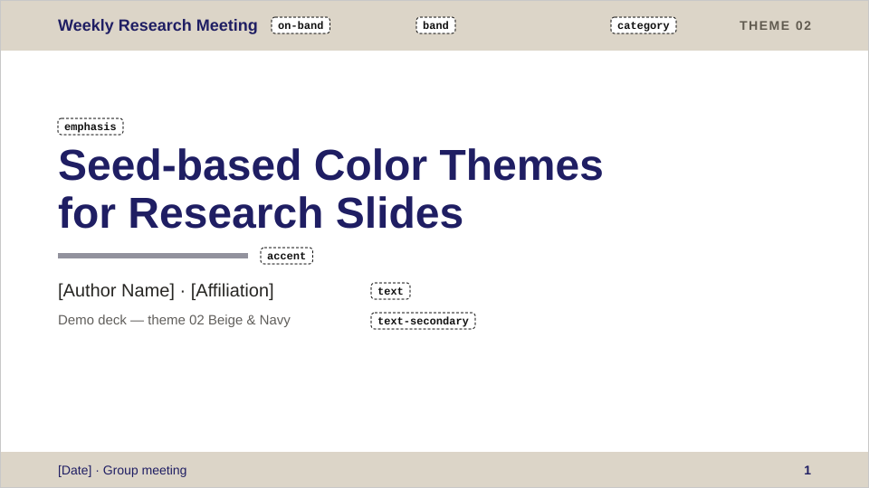
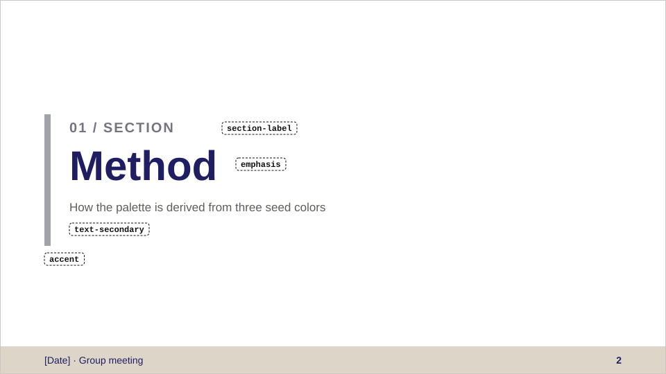
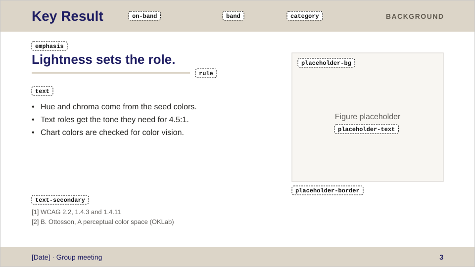
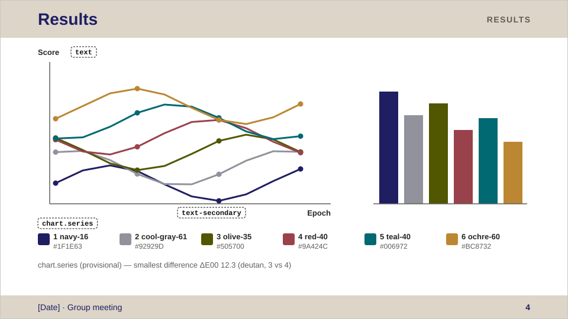
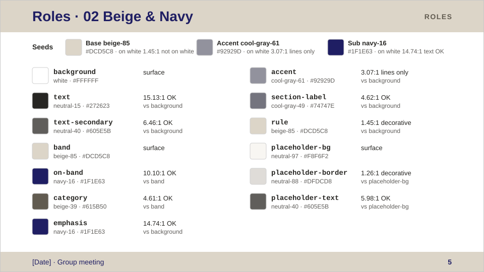

# 02 Beige & Navy

ベージュの帯にネイビーの文字を載せ、強調もネイビーでそろえる。アクセントはクールグレー。種色は研究ミーティング用 PPTX テンプレートのテーマ配色（accent4〜6）。

- 種色: ベース = ベージュ、アクセント = クールグレー、サブ = ネイビー
- 正本: [theme.json](theme.json)（色の値はここだけで管理する。この README には hex を書かない）
- 見本スライド: 下の[プレビュー](#プレビュー)。色見本・コントラスト比・種色の判定: リポジトリの [README のテーマ一覧](../../README.md#テーマ一覧)、[dist/02/swatches.svg](../../dist/02/swatches.svg)

## プレビュー

<!-- BEGIN GENERATED: preview -->
<!-- この区間は scripts/build.py が生成する。手で編集しないこと。 -->

見本スライド 5 枚。点線の枠は、その部分に使っている role の名前。色は [theme.json](theme.json) の値そのまま（画像は [dist/02/preview/](../../dist/02/preview/)）。

**表紙** — `on-band`・`band`・`category`・`emphasis`・`accent`・`text`・`text-secondary`

**セクション扉** — `accent`・`section-label`・`emphasis`・`text-secondary`

**本文** — `on-band`・`band`・`category`・`emphasis`・`rule`・`text`・`text-secondary`・`placeholder-bg`・`placeholder-text`・`placeholder-border`

**グラフ** — `text`・`text-secondary`・`chart.series`

**役割一覧** — 種色 3 つと全 role の色・palette 名・コントラスト比

<!-- END GENERATED: preview -->

## 色の使い分け

| 場面 | 使う role | ルール |
|---|---|---|
| スライドの地 | `background` | |
| 本文 | `text` | |
| 参考文献・図キャプション | `text-secondary` | 補足情報だけに使う |
| ヘッダー帯・フッター帯 | `band` | 塗りだけに使う。帯の上の文字は `on-band` |
| 帯の上のタイトル・日付・会議名・ページ番号 | `on-band` | `band` の上で使う |
| 帯の右上のカテゴリラベル | `category` | `band` の上でだけ使う（ベージュを暗くした色） |
| 表紙タイトル・セクションタイトル・キーメッセージ・Takeaway | `emphasis` | 強調はこの色で行う（ベースのベージュは白地で読めないので、サブのネイビー） |
| 表紙のアクセントライン・セクション扉の縦バー | `accent` | **白地で約 2.5:1 と淡く、線・図形の基準 3:1 にも届かない。** 装飾的な線にとどめ、意味を担う線・アイコンには使わない |
| セクション扉の「01 / SECTION」 | `section-label` | クールグレーを暗くした色で、小さい文字の基準 4.5:1 を満たす |
| キーメッセージ下の区切り線 | `rule` | 装飾用。白地ではかなり淡いので、情報を担わせない |
| 図のプレースホルダー | `placeholder-bg` / `placeholder-border` / `placeholder-text` | 仮置き専用。実際の図に差し替える |

`emphasis` と `on-band` が同じネイビーになる。強調の段階は色ではなく、サイズや太さで差をつける。

## グラフ

- 系列色は `chart.series` の順に使う（matplotlib なら `theme.mplstyle` の色サイクル）。**暫定案・要確認**。
- 1 = ネイビー（種色）、2 = クールグレーを線に使える明度まで暗くした色。3〜6 は見分けやすさで選んだ追加色（オリーブ・赤・ティール・黄土）。
- ベースのベージュは系列に入れていない（線に使える明度まで暗くすると、2 のグレーと見分けにくくなる）。
- 2 のグレーは目立たないので、比較の基準線や「その他」に向く。
- 軸・目盛りは `text-secondary`、ラベル・タイトルは `text`。

## フォント

欧文 Arial、和文 Meiryo UI。ない環境では欧文 Helvetica、和文 Hiragino Sans / Noto Sans JP の順に代替する。
