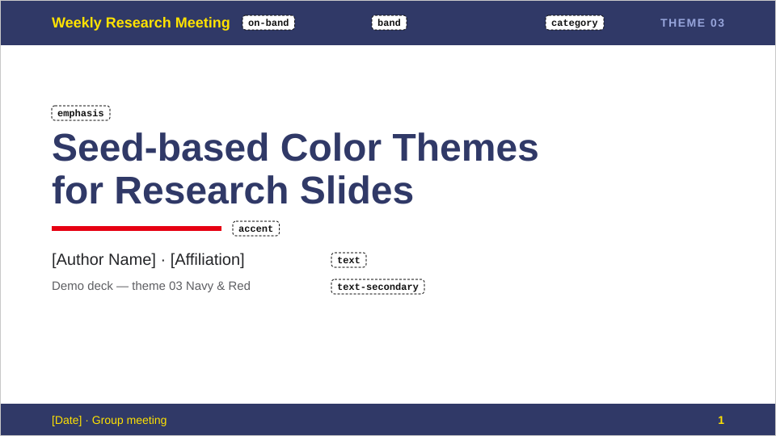
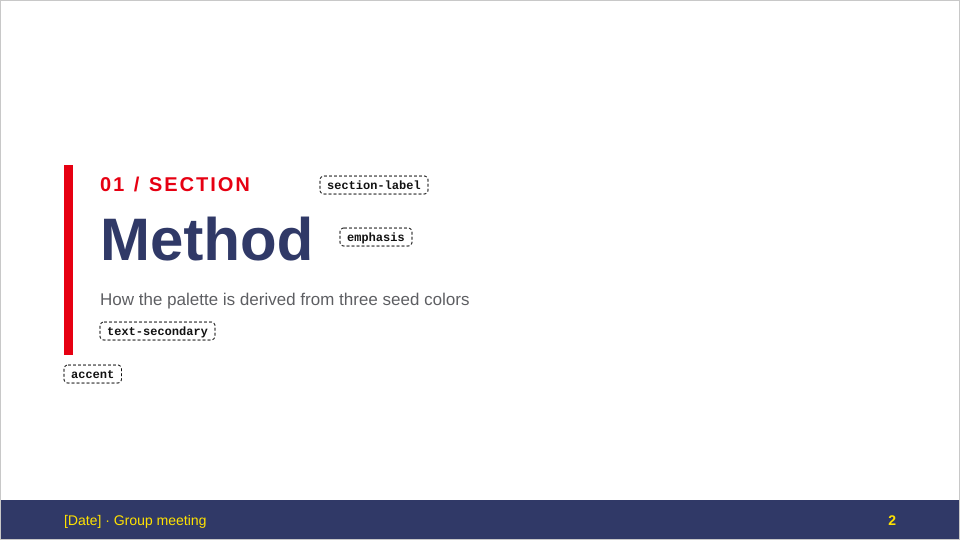
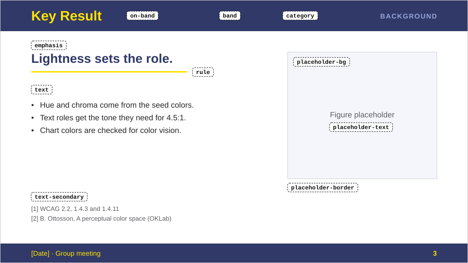
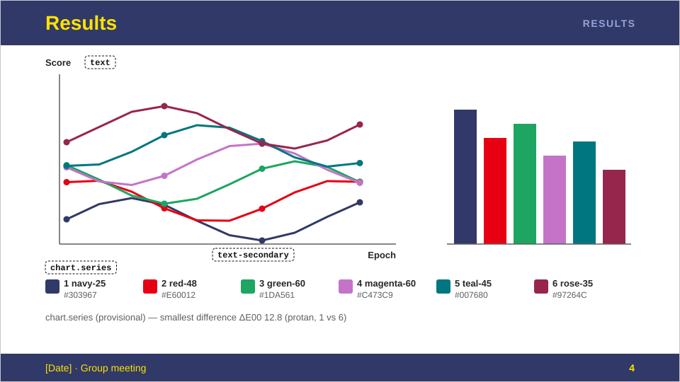
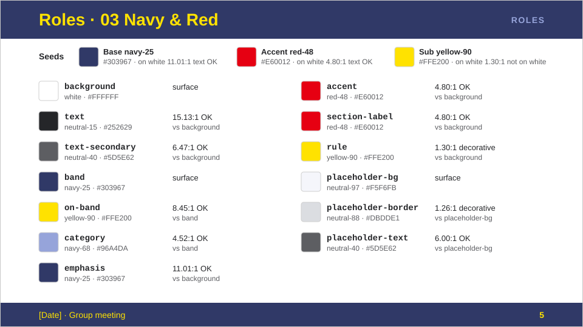

# 03 Navy & Red

ネイビーの帯に黄色の文字を載せ、赤をアクセントに使う。コントラストの強い配色。

- 種色: ベース = ネイビー、アクセント = 赤、サブ = 黄
- 正本: [theme.json](theme.json)（色の値はここだけで管理する。この README には hex を書かない）
- 見本スライド: 下の[プレビュー](#プレビュー)。色見本・コントラスト比・種色の判定: リポジトリの [README のテーマ一覧](../../README.md#テーマ一覧)、[dist/03/swatches.svg](../../dist/03/swatches.svg)

## プレビュー

<!-- BEGIN GENERATED: preview -->
<!-- この区間は scripts/build.py が生成する。手で編集しないこと。 -->

見本スライド 5 枚。点線の枠は、その部分に使っている role の名前。色は [theme.json](theme.json) の値そのまま（画像は [dist/03/preview/](../../dist/03/preview/)）。

**表紙** — `on-band`・`band`・`category`・`emphasis`・`accent`・`text`・`text-secondary`

**セクション扉** — `accent`・`section-label`・`emphasis`・`text-secondary`

**本文** — `on-band`・`band`・`category`・`emphasis`・`rule`・`text`・`text-secondary`・`placeholder-bg`・`placeholder-text`・`placeholder-border`

**グラフ** — `text`・`text-secondary`・`chart.series`

**役割一覧** — 種色 3 つと全 role の色・palette 名・コントラスト比

<!-- END GENERATED: preview -->

## 色の使い分け

| 場面 | 使う role | ルール |
|---|---|---|
| スライドの地 | `background` | |
| 本文 | `text` | |
| 参考文献・図キャプション | `text-secondary` | 補足情報だけに使う |
| ヘッダー帯・フッター帯 | `band` | 塗りだけに使う。帯の上の文字は `on-band` |
| 帯の上のタイトル・日付・会議名・ページ番号 | `on-band` | `band` の上でだけ使う（黄。**白地では約 1.3:1 で読めない**） |
| 帯の右上のカテゴリラベル | `category` | `band` の上でだけ使う（ネイビーを明るくした色） |
| 表紙タイトル・セクションタイトル・キーメッセージ・Takeaway | `emphasis` | 強調はこの色で行う |
| 表紙のアクセントライン・セクション扉の縦バー | `accent` | 赤。白地で約 4.8:1 あり、線・図形にも文字にも使える |
| セクション扉の「01 / SECTION」 | `section-label` | `accent` と同じ赤 |
| キーメッセージ下の区切り線 | `rule` | 黄。装飾用で、白地ではかなり淡い。情報を担わせない |
| 図のプレースホルダー | `placeholder-bg` / `placeholder-border` / `placeholder-text` | 仮置き専用。実際の図に差し替える |

赤は注意を強く引くので、`accent` と `section-label` 以外（本文中の強調など）には広げない。強調は `emphasis`（ネイビー）で行う。

## グラフ

- 系列色は `chart.series` の順に使う（matplotlib なら `theme.mplstyle` の色サイクル）。**暫定案・要確認**。
- 1 = ネイビー、2 = 赤（種色）。3〜6 は見分けやすさで選んだ追加色（緑・マゼンタ・ティール・ワイン）。
- サブの黄は系列に入れていない（線に使える明度まで暗くするとオリーブ色になり、2 型色覚で赤と見分けにくくなる）。
- 2 の赤と 3 の緑は、色覚シミュレーションでも明度の差で区別できるように選んでいる（全ペアの最小の色差は ΔE00 約 13）。
- 軸・目盛りは `text-secondary`、ラベル・タイトルは `text`。

## フォント

欧文 Arial、和文 Meiryo UI。ない環境では欧文 Helvetica、和文 Hiragino Sans / Noto Sans JP の順に代替する。
